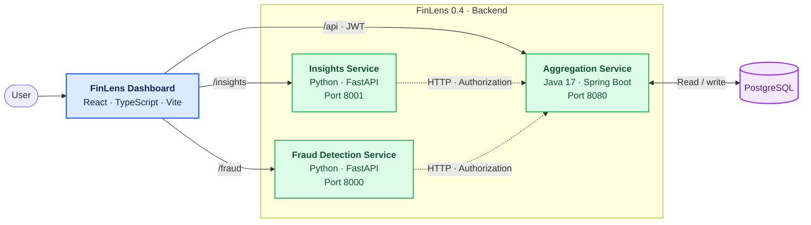

# FinLens 0.4 — Personal Fintech Monitoring Platform

FinLens is a personal fintech portfolio project that brings financial account data, spending insights, and transaction anomaly detection into one dashboard.

The application uses a microservices architecture with a React frontend, a Spring Boot aggregation service, two Python/FastAPI services, and PostgreSQL. It demonstrates how financial data can be collected, analyzed, and presented through separate services with clearly defined responsibilities.

**Version:** 0.4  
**Project type:** Personal portfolio / demonstration application  
**Status:** Locally runnable application; not connected to real banking infrastructure

## Table of Contents

- [Features](#features)
- [Architecture](#architecture)
- [How the System Works](#how-the-system-works)
- [Technology Stack](#technology-stack)
- [Fintech Concepts](#fintech-concepts)
- [API Overview](#api-overview)
- [Running Locally](#running-locally)
- [Testing](#testing)
- [Project Structure](#project-structure)
- [Limitations and Future Improvements](#limitations-and-future-improvements)

## Features

### 1. Account aggregation

- Retrieve financial accounts and their associated transactions through a unified backend API.
- Store and retrieve account data using PostgreSQL.
- Authenticate users through registration and login endpoints.
- Protect account access with JWT-based authentication.

### 2. Spending insights

The Insights service analyzes aggregated financial data and provides rule-based observations, including:

- Spending patterns and category-level changes.
- Potential recurring transactions and subscriptions.
- Estimated balance trends based on historical net cash flow.

These are deterministic calculations based on available transaction data, not predictions generated by a machine-learning model.

### 3. Transaction anomaly detection

The Fraud service implements a transaction-velocity rule that identifies unusually frequent outgoing transactions within a rolling time window.

For example, five outgoing transactions within ten minutes can trigger a flag.

The result is a potential anomaly, not proof of fraud. The rule is deliberately simple and can produce both false positives and false negatives.

### 4. Dashboard

The React frontend brings the services together in a single interface, displaying account and transaction data, financial insights, and detected fraud flags.

The dashboard includes separate sections for overview, security, transactions, and insights, alongside authentication and sign-out functionality.

## Architecture

FinLens separates data access and aggregation from financial analysis. The frontend communicates with the services through HTTP APIs, while the Insights and Fraud services obtain the account data they need from the Aggregation service.



### Service responsibilities

| Component | Responsibility |
|---|---|
| Frontend | Authentication interface, dashboard, and presentation of account data, insights, and fraud flags |
| Aggregation service | User authentication, account and transaction retrieval, and database access |
| Insights service | Analysis of financial data and generation of rule-based insights |
| Fraud service | Evaluation of transaction activity using anomaly-detection rules |
| PostgreSQL | Persistent storage for application data |
| Docker Compose | Container configuration for the services currently included in the Compose setup |

The frontend uses Vite development-server proxies to route `/api` requests to the Aggregation service, `/insights` requests to the Insights service, and `/fraud` requests to the Fraud service.

The Python services call the Aggregation service over HTTP and forward the authorization header when requesting protected data.

## How the System Works

### Example: Detecting a burst of transactions

1. A user signs in through the frontend and receives a JWT.
2. The frontend requests the user's account and transaction data from the Aggregation service.
3. The dashboard requests fraud flags from the Fraud service.
4. The Fraud service retrieves the relevant transaction data from the Aggregation service, forwarding the authorization header.
5. The service evaluates outgoing transactions against its rolling time-window rule.
6. Matching transactions are returned as fraud flags and displayed in the dashboard.

The current velocity rule uses transaction frequency within a time window. It does not independently establish whether a transaction is fraudulent.

### Example: Generating financial insights

1. The frontend requests insights for the authenticated user.
2. The Insights service retrieves the required account data.
3. The service applies its implemented rules to the available financial history.
4. The resulting observations and projections are returned to the frontend.

The quality of these insights depends on the completeness and reliability of the available transaction data.

## Technology Stack

| Area | Technology |
|---|---|
| Frontend | React 19, TypeScript, Vite |
| Aggregation backend | Java 17, Spring Boot 3.4.1, Maven |
| Insights backend | Python 3.12, FastAPI |
| Fraud backend | Python 3.12, FastAPI |
| Database | PostgreSQL |
| Authentication | JWT |
| API communication | HTTP / REST |
| Containerization | Docker, Docker Compose |
| Testing | JUnit/Maven and pytest, as configured in each service |
| CI | GitHub Actions |

## Fintech Concepts

FinLens provides a practical way to explore several concepts relevant to financial software engineering.

### Open banking and data aggregation

Open banking systems allow authorized access to financial data through defined interfaces and permissions.

FinLens uses an **open-banking-inspired aggregation pattern**, but it does not connect to real banks or implement a regulated open banking integration. Its account data is intended for demonstration.

### Authentication and authorization

Authentication answers, "Who is making this request?"

Authorization answers, "What is this user allowed to access?"

FinLens uses JWT-based authentication and forwards authorization headers when the analytical services retrieve protected data from the Aggregation service. These mechanisms help demonstrate how identity and access checks fit into a multi-service application.

A production implementation would also need careful validation of token handling, ownership checks, secret management, and security configuration.

### Rule-based fraud detection

Transaction velocity is a simple anomaly signal: an unusually high number of transactions in a short period may indicate suspicious activity.

A production fraud system would generally need additional context, such as transaction amounts, merchant information, historical behavior, and other risk signals. It would also need evaluation against labelled outcomes and explicit trade-offs between false positives and missed fraud.

FinLens currently demonstrates a deterministic heuristic rather than a trained fraud-detection model.

### Idempotency and reliable payment processing

In payment-processing systems, clients may retry a request after a timeout without knowing whether the original request succeeded. Idempotency mechanisms help prevent the same logical operation from being processed multiple times.

FinLens analyzes financial records; it does not currently process payments or implement payment idempotency. This is a relevant concept for a future extension into payment workflows.

### Microservices and service boundaries

Separating aggregation, insights, and fraud detection gives each service a focused responsibility and an independent codebase.

The trade-off is additional operational complexity: network failures, authorization propagation, service availability, configuration, logging, and integration testing become important. The services are logically separate, but that alone does not mean the application is production-ready or independently scalable.

## API Overview

The following endpoints describe the application's main interfaces. Authentication requirements should be checked against the current endpoint implementation.

### Aggregation service — port 8080

| Method | Path | Purpose |
|---|---|---|
| POST | `/auth/register` | Register a user |
| POST | `/auth/login` | Authenticate a user and obtain a JWT |
| GET | `/accounts` | Retrieve accounts and transactions for the authenticated user |

### Insights service — port 8001

| Method | Path | Purpose |
|---|---|---|
| GET | `/insights/{user_id}` | Retrieve spending insights and balance projections |
| GET | `/health` | Health check |

### Fraud service — port 8000

| Method | Path | Purpose |
|---|---|---|
| GET | `/fraud/flags/{user_id}` | Retrieve detected transaction anomaly flags |
| GET | `/health` | Health check |

The Insights and Fraud services depend on the Aggregation service being reachable and on the relevant authorization information being accepted.

## Running Locally

### Prerequisites

- Java 17
- Maven
- Python 3.12
- Node.js and npm
- Docker and Docker Compose for the containerized database

Run the commands below from the repository root. The Python activation commands are for Windows PowerShell.

### 1. Start PostgreSQL

```powershell
docker compose up -d postgres
```

Ensure the database credentials, database name, and port in the Aggregation service configuration match the PostgreSQL instance you intend to use.

### 2. Start the Aggregation service

In a new terminal:

```powershell
cd aggregation-service
mvn spring-boot:run
```

The service is expected to listen on port `8080` under the current local configuration.

### 3. Start the Insights service

In a new terminal:

```powershell
cd insights-service
python -m venv venv
.\venv\Scripts\Activate.ps1
pip install -r requirements.txt
uvicorn app.main:app --reload --port 8001
```

### 4. Start the Fraud service

In a new terminal:

```powershell
cd fraud-service
python -m venv venv
.\venv\Scripts\Activate.ps1
pip install -r requirements.txt
uvicorn app.main:app --reload --port 8000
```

### 5. Start the frontend

In another terminal:

```powershell
cd frontend
npm install
npm run dev
```

Open the local URL printed by Vite, normally `http://localhost:5173`.

The frontend's development-server proxies route requests to the corresponding backend ports. If a request fails, verify that all required services are running and that their database and service URLs match your local configuration.

### Docker Compose

Docker Compose currently provides the containerized components defined in `docker-compose.yml`; it should not be assumed to launch the complete application by itself.

Inspect the Compose configuration to determine which services it starts. Start any services not included there separately using the instructions above.

## Testing

Run the tests for each service separately.

### Aggregation service

```powershell
cd aggregation-service
mvn clean test
```

### Insights service

```powershell
cd insights-service
.\venv\Scripts\python -m pytest tests/ -v
```

### Fraud service

```powershell
cd fraud-service
.\venv\Scripts\python -m pytest tests/ -v
```

### Frontend

```powershell
cd frontend
npm run build
```

These commands describe how to run the checks; they do not imply that every test suite currently passes. Check the latest output before reporting test results.

## Project Structure

```text
finlens/
├── aggregation-service/
│   ├── Dockerfile
│   ├── pom.xml
│   └── src/
├── insights-service/
│   ├── Dockerfile
│   ├── requirements.txt
│   ├── app/
│   │   ├── insights.py
│   │   ├── main.py
│   │   └── models.py
│   └── tests/
├── fraud-service/
│   ├── Dockerfile
│   ├── requirements.txt
│   ├── app/
│   │   ├── fraud.py
│   │   └── main.py
│   └── tests/
├── frontend/
│   ├── package.json
│   ├── vite.config.ts
│   └── src/
│       ├── auth/
│       └── pages/
├── .github/
│   └── workflows/
├── docker-compose.yml
└── README.md
```

## Limitations and Future Improvements

FinLens is a portfolio and learning project, not a production banking platform.

Current boundaries include:

- No live bank connections or real payment processing.
- Synthetic/demo financial data rather than verified customer banking records.
- Rule-based transaction anomaly detection rather than a trained model.
- No claim of production-grade fraud accuracy or comprehensive security certification.
- Local development configuration; public deployment and production infrastructure are separate tasks.

Potential next steps include:

- Expand automated tests around authentication, service-to-service requests, and error handling.
- Add structured logging, request correlation, and clearer service health checks.
- Evaluate the fraud rule using realistic test cases, including false positives and missed anomalies.
- Improve configuration and deployment reproducibility.
- Document security assumptions and validate authorization at each service boundary.

The goal of FinLens 0.4 is to demonstrate a coherent microservices application and provide a clear basis for discussing backend architecture, API design, data analysis, and the trade-offs involved in financial software.
